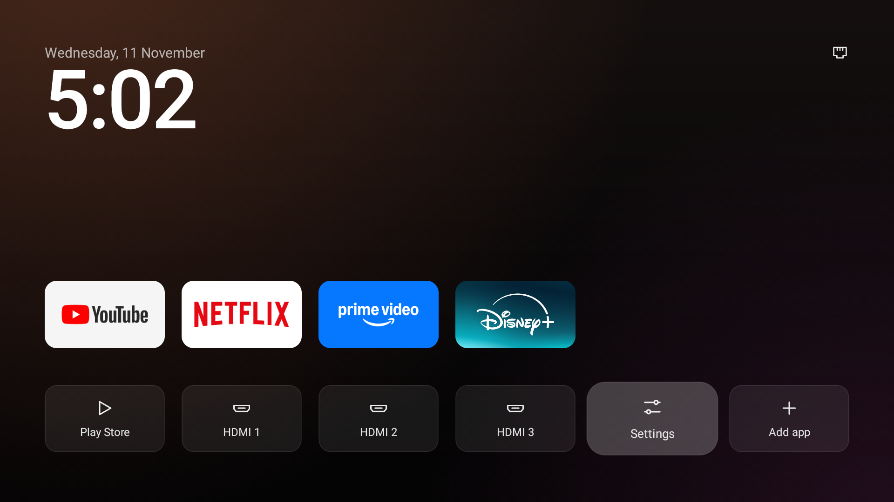
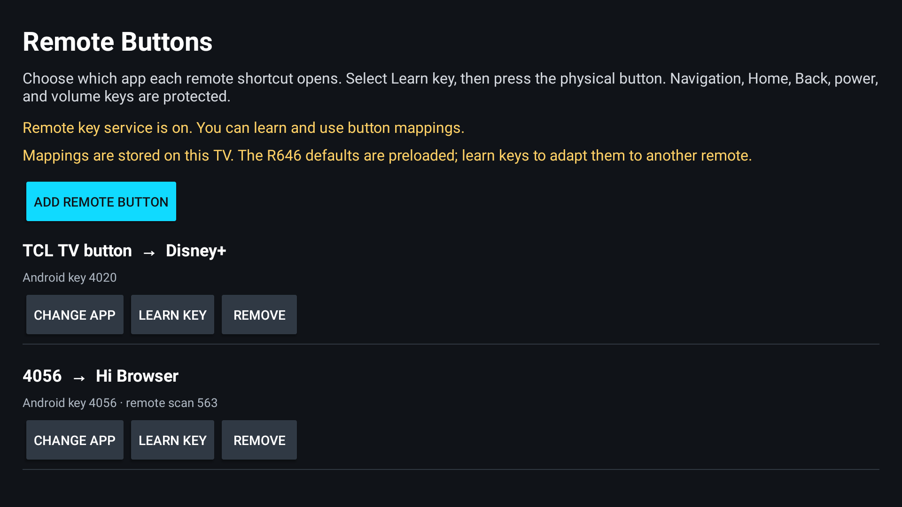

# Remote button mappings

TV Detox can remap physical remote shortcut buttons to apps already installed on the TV.

This feature is maintained in this fork because the upstream project keeps its scope to official
apps and Android settings. The mapping service is an optional Android Accessibility service: it
receives remote key events, filters only keys you map, cannot inspect screen content, and has no
network permission.

## Open the editor

On the TV, open **Settings → Remote buttons**.

The first time you use key learning, choose **Open Accessibility settings** and enable **TV Detox**.
Android asks you to confirm this because an accessibility service can receive remote key events. This
service filters only mapped keys; it cannot read screen contents and has no network permission.

## Change a button

- **Change app** picks the app that an existing button opens.
- **Learn key** waits for you to press the physical remote shortcut. The mapping saves immediately.
- **Add remote button** lets you choose an app first, then press a remote shortcut to map it.
- **Remove** returns that button to the TV’s normal behavior.

The R646 profile (Netflix, YouTube, TCL TV, and Prime Video) is seeded only on TCL's `G05_4K_US`
product family. Other TVs start with no preset shortcuts; use **Add remote button** or **Learn key**
to record the Android key code and scan code they receive. A TV may consume a shortcut in firmware
before Android sees it; those buttons cannot be mapped by an app.

Home, Back, menu, navigation, Enter, power, volume, and channel keys are protected from learning.
Mappings are private to the TV and stored in TV Detox app data.

If you previously enabled the standalone **TV Detox Remote Buttons** helper, turn that service off
in Accessibility before enabling TV Detox’s built-in service. Only one service should handle these
shortcut keys at a time.

To undo, turn off **TV Detox** in Android’s Accessibility settings. This disables all remote key
mappings without changing the apps they target.
